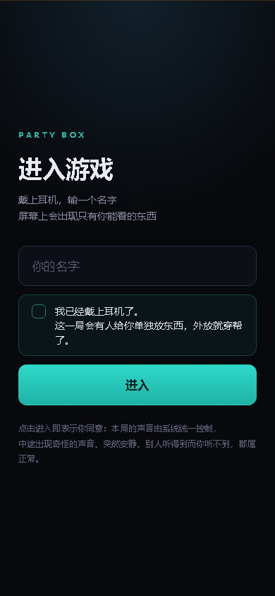

# 聚会游戏机 · Party Box

一台笔记本 + 一块投屏 + 每人一部手机，就是一个能开局的聚会现场。
**13 个派对游戏 · 零第三方依赖 · 787 项自动化自检 · 全程局域网，不联网也能玩。**

*Party games for a room full of people. One laptop, one screen, everyone's phone as a controller. Zero dependencies, fully offline LAN.*


| 主持台 | 玩家手机 | 手机遥控 |
|---|---|---|
|  |  |  |

---

## 它解决什么问题

十几个人聚会，常见的结局是：一半人干看、主持人忙着点鼠标、规则讲八遍、空档期全员刷手机。

这套东西的分工是固定的：

- **投屏**只负责「大家现在该看什么」，永远不发声（声音只从主持机出去，避免双声和延迟）。
- **手机**只负责「只有你能看的东西」——身份、词、投票、抢答；其余时间鼓励扣在桌上。
- **主持台**是导演台：提词器告诉你下一步说什么，仪式动作负责转场，裁决条负责「谁先答对」。

## 13 个游戏

| 类型 | 游戏 |
|---|---|
| 破冰暖场 | 传声筒 · 你画我猜 · 接力猜词 |
| 推理对抗 | 谁是卧底 · 狼人杀 · 笨蛋杀手 |
| 反应抢答 | 报数抢答 · 数字炸弹 · 听歌识曲 |
| 全员动起来 | 舞蹈狼人杀 · 重复就打飞 |
| 收尾 | 你们认了吗 · 好奇宝 |

其中报数抢答、听歌识曲、数字炸弹、重复就打飞支持「大屏控场」：不用每人掏手机，倒数结束直接喊，主持人用裁决台判名次。

## 30 秒跑起来

需要 Node.js 18+，没有任何 npm 依赖。

```bash
node server.js
```

然后：

| 谁 | 打开 |
|---|---|
| 主持（这台电脑） | `http://localhost:3210/host` |
| 投屏（另一台或同机） | `http://<局域网IP>:3210/screen` |
| 玩家（手机扫码） | `http://<局域网IP>:3210/play` |

Windows 直接双击 `start.bat`，macOS / Linux 用 `./start.sh`。
投屏地址带主持人密钥，只把「玩家入口」发给别人。

## 主持台做了什么

- **主持脚本 + 提词器**：每个游戏声明一条时间线，中栏显示「现在该说什么、下一步是什么」，不用背流程。
- **仪式动作**：发身份 / 宣布死亡 / 揭晓 / 静场 / 倒计时 / 推大字，投屏全屏动画；除倒计时外常驻，由主持人撤，换游戏自动收。
- **裁决台**：点名字 → 判对 / 判错，分数由游戏自己声明，底座不替游戏定分。
- **手机遥控**：6 位临时码，走开也能推进流程；权限边界写死在程序里，不靠隐藏按钮。
- **素材库**：词库和音频一个入口；曲目可上传、可删、可从指定秒数开始播。
- **结算页**：再来一局 / 换游戏 / 收工，外加返回本局、打印手写记分表。
- **综艺模式**：隐藏分数、换称号、惩罚卡、名场面；比赛模式保留完整排行。

## 架构

```
server.js          静态服务 + JSON API + SSE 广播（零依赖）
core/              房间、游戏注册、提词器、仪式、裁决、音频、词库、统计…
games/<id>/        每个游戏一个插件：init / setup / actions / 三端视图
public/            host.html（导演台） screen.html（投屏） play.html（手机） remote.html（遥控）
packs/             内置词库（JSON）
tools/check/       13 个自检脚本
docs/              快速上手、开箱卡、截图、完整手册
```

游戏插件只声明四件事：初始状态、开局、动作、三个视图（主持台 / 投屏 / 玩家）。
加一个新游戏不需要改 core，也不需要改前端。

## 自检

```bash
node tools/check/check.js          # 语法 + 插件 + 词库（不用起服务）

PORT=3321 node server.js           # 另开一个窗口
PORT=3321 node tools/check/smoke.js
PORT=3321 node tools/check/extracheck.js
```

13 个脚本合计 **787 项**，覆盖：全流程冒烟、破坏性输入、三种模式、投票与计分、跨端视图、遥控权限、拖拽与音频、界面点击路径。每次改完跑一遍，全绿再打包。

## 已知限制

- 只面向**局域网**，没有公网部署方案；投屏和主持机建议同一台设备或同一网段。
- 音效与曲目**不随仓库分发**，`media/`、`sfx/` 由使用者自行放入，版权自负。
- 中文优先：界面、文案、注释都是中文，英文只覆盖 README。
- 没有账号体系，所有人靠房间号 / 扫码进入。

## 文档

- [十分钟上手与一晚流程](docs/quick-start.md)
- [开箱卡（A4 可打印）](docs/quick-start-card.html)
- [完整手册](docs/handbook.md)

## 许可

**AGPL-3.0-or-later**，见 [LICENSE](LICENSE)。

个人聚会、内部使用随便用；把修改版分发出去、或做成对外服务，需要按 AGPL 公开完整对应源码。
闭源集成、SaaS、客户定制交付这类场景，走 [商业授权](COMMERCIAL.md)（微信 / 电话 17685232410）。
